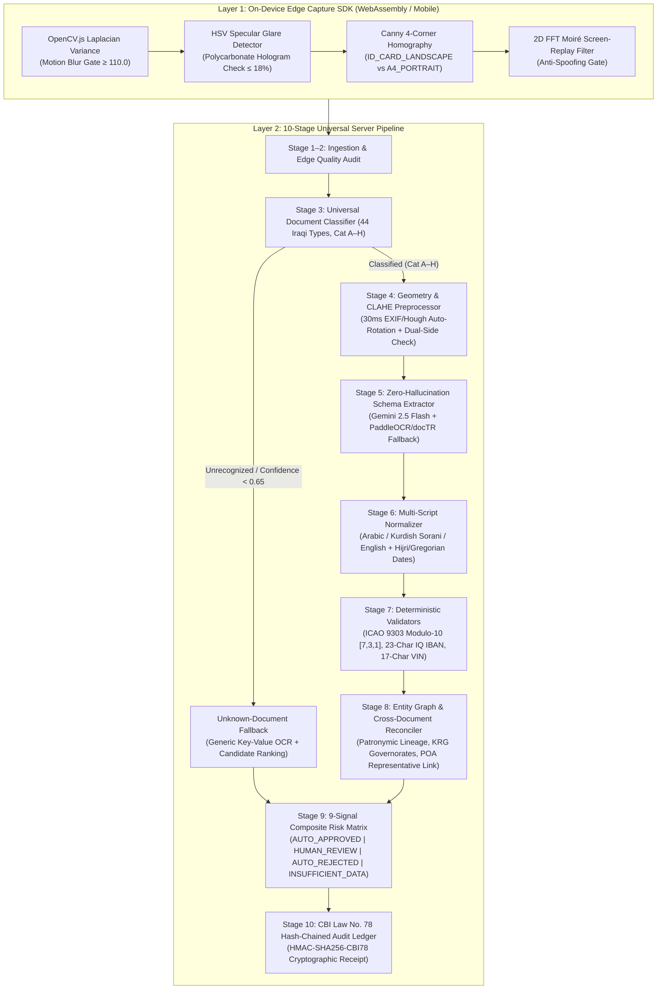

# System Architecture — Project Rostro (`مشروع روسترو للامتثال`)

> **Architectural Specification v3.0.0**  
> **Domain:** Universal Iraqi & Kurdistan Region (KRG) Document Intelligence, Forensics & KYC Compliance  
> **Regulatory Framework:** Central Bank of Iraq (CBI) Electronic Transactions Law No. 78 of 2012 & AML/CFT Law No. 39 of 2015

---

## 1. Architectural Philosophy & Design Principles

**Project Rostro** is engineered as a modular, registry-driven **Universal Document Intelligence Platform** rather than a hardcoded 3-document scanner. The system separates **probabilistic vision perception** (OCR & spatial layout extraction) from **deterministic mathematical verification** (ICAO check digits, multi-script normalization, dual-side physical card policies, and cryptographic non-repudiation).

### Core Engineering Tenets
1. **Declarative Registry Over Procedural Branching:** All 44 Iraqi and KRG document types across Categories `A–H` are defined in a single versioned, startup-validated registry ([`backend/kyc_app/registry/iraqi_document_registry.js`](backend/kyc_app/registry/iraqi_document_registry.js)).
2. **Deterministic Mathematical Supremacy:** Generative vision models (`Gemini 2.5 Flash`) extract structured text and normalized `[ymin, xmin, ymax, xmax]` coordinates, but **never** decide approval or override deterministic checksums (`computeIcaoCheckDigit`).
3. **Unknown-Document Safety Valve:** Unrecognized or low-confidence (`< 0.65`) uploads trigger a generic layout key-value fallback, rank candidate categories, mark `UNSUPPORTED_OR_UNCERTAIN_CLASSIFICATION`, and route to `HUMAN_REVIEW`.
4. **9 Independently Inspectable Signals:** Every verification packet outputs 9 orthogonal signals so compliance officers can distinguish an image quality defect from a checksum forgery or an unavailable external government registry.

---

## 2. End-to-End 10-Stage Processing Pipeline



---

## 3. On-Device Edge vs. Server Forensics Stack

| Layer | Component / Tool | Engineering Function | Threshold / Rule |
| :--- | :--- | :--- | :--- |
| **On-Device Edge** | `OpenCV.js` (Laplacian 2D Filter) | Computes variance of Laplacian (`Var(∇²I)`) at 30 FPS on the phone camera feed to block motion blur before upload. | `blur_score >= 110.0` |
| **On-Device Edge** | `OpenCV.js` (HSV Luminance Histogram) | Detects overhead fluorescent reflection on polycarbonate Iraqi National IDs (`V > 248`, `S < 15`) and prompts the user to tilt the card `15°`. | `glare_penalty <= 0.18` |
| **On-Device Edge** | Canny Edge + `findContours` + `warpPerspective` | Locks onto the 4 outer corners of CR80 cards (`85.60 × 53.98 mm`) or A4 sheets (`210 × 297 mm`) and flattens perspective distortion. | `boundary_completeness >= 0.90` |
| **On-Device Edge** | `MobileNetV3-Small` (`ONNX` / `TFLite`) | Lightweight (`3.2 MB`, `15ms`) on-device classifier that detects Front vs. Back side during the live camera session. | Prompts *"Flip card to capture Back Side (الوجه الخلفي)"* |
| **On-Device Edge** | 2D Fast Fourier Transform (FFT) | Detects high-frequency pixel grid interference patterns (Moiré rings) when photographing another phone or monitor screen. | Blocks screen-replay spoofing |
| **Server Forensics** | `30ms` Orientation & `CLAHE` Normalizer | Corrects `90° / 180° / 270°` rotation and enhances faded purple ink stamps on paper Civil IDs and Residence Cards. | Never rotates upright `A4_PORTRAIT` certificates sideways |
| **Server Forensics** | Dual-Side Physical Card Gate | Verifies that 2-sided cards (`IRQ_NATIONAL_ID`, `IRQ_CIVIL_STATUS_ID`, `IRQ_RESIDENCE_CARD`, `IRQ_DRIVING_LICENSE`) include both `FRONT` and `BACK`. | Blocks `AUTO_APPROVED` if either side is missing |
| **Server Forensics** | ICAO Doc 9303 Modulo-10 `[7, 3, 1]` | Deterministic mathematical verification of TD1 (`3×30`) and TD3 (`2×44`) MRZ check digits (`doc_number`, `dob`, `expiry`, `composite`). | Zero LLM override allowed |
| **Server Forensics** | `OpenCV SSIM` Ghost Portrait Analyzer | Compares the primary portrait against the laser-engraved secondary ghost window on the Iraqi National Card to detect photo-swap tampering. | `SSIM >= 0.82` |

---

## 4. The 9 Independently Inspectable Verification Signals

Every response from `/api/kyc/extract` and `/api/v1/kyc/verify` returns a structured `nineSignals` (`verification_signals`) object:

1. **`image_quality`** — Blur score, specular glare ratio, orientation correction, and boundary completeness.
2. **`text_extraction_confidence`** — Mean optical confidence and zero-hallucination missing/unclear field quarantine.
3. **`classification_confidence`** — Category (`A–H`), specific document type ID, support tier (`TESTED`, `CONFIGURED`, `REGISTERED`), and fallback status.
4. **`field_completeness`** — Required schema fields present vs. missing, plus dual-side (`FRONT + BACK`) satisfaction.
5. **`data_consistency`** — Cross-document Arabic/Kurdish/English patronymic name alignment and governorate/address reconciliation.
6. **`duplicate_detection`** — SHA-256 document identifier & image hash replay tracking across onboarding sessions.
7. **`authenticity_indicators`** — Deterministic ICAO Modulo-10 MRZ check digits, Ghost Portrait SSIM, and stamp geometry.
8. **`external_authoritative_verification`** — Explicitly reports `EXTERNAL_VERIFICATION_UNAVAILABLE` unless an authorized government API integration is active.
9. **`final_policy_decision`** — Deterministic Stage 9 routing outcome (`AUTO_APPROVED`, `HUMAN_REVIEW`, `AUTO_REJECTED`, or `INSUFFICIENT_DATA`).

---

## 5. Repository Directory Structure

```text
rostro-kyc/
├── .github/
│   ├── ISSUE_TEMPLATE/             # Structured YAML bug & new-document-type templates
│   ├── workflows/
│   │   └── ci.yml                  # Automated GitHub Actions build & 55-test verification pipeline
│   ├── CODEOWNERS                  # Repository code ownership & review routing
│   └── PULL_REQUEST_TEMPLATE.md    # Enterprise PR security & compliance checklist
├── assets/
│   └── branding/                   # Official Rostro visual identity & brand mark specimens
├── backend/
│   ├── app/                        # Transaction risk & anti-scam Python services
│   ├── kyc_app/
│   │   ├── registry/
│   │   │   └── iraqi_document_registry.js  # Centralized 44-document Iraqi & KRG registry (Cat A–H)
│   │   └── services/
│   │       ├── universal_pipeline.js       # 10-Stage Universal Document Processing Pipeline
│   │       ├── hybrid_kyc_engine.js        # Multimodal Gemini 2.5 Flash + deterministic validators
│   │       ├── arabic_normalizer.py        # Iraqi Arabic & Kurdish Sorani onomastic normalizer
│   │       └── cross_doc_reconciler.py     # Multi-document entity graph & POA lineage reconciler
│   └── tests/
│       └── test_hybrid_server.js           # 55-assertion automated verification suite
├── data/
│   └── synthetic_kyc/
│       ├── sample_document_sets.json       # 14 multi-category synthetic Iraqi onboarding packets
│       └── faker_specimens/                # Synthetic visual specimens generated via Python Faker
├── docs/
│   ├── DOCUMENT_COVERAGE_MATRIX.md         # Full 44-document coverage matrix & validation rules
│   ├── blueprints/                         # Executive PDF architectural blueprints
│   └── rostro_kyc_architecture.md          # Deep-dive KYC engineering reference
├── frontend/
│   └── kyc_cockpit/
│       └── dist/                           # Compiled production React 19 + Tailwind v4 bundle
├── scripts/
│   └── generate_faker_iraqi_documents.py   # Synthetic Iraqi specimen generator (Faker ar_AA + Pillow)
├── src/
│   ├── App.tsx                             # Main Rostro Compliance Console application
│   ├── components/
│   │   ├── ApplicantInspectorDrawer.tsx    # 9-Signal case inspector & CBI Law 78 adjudication drawer
│   │   ├── DocumentSpecimenViewer.tsx      # Interactive Front/Back specimen & MRZ bounding-box viewer
│   │   ├── SecureUploadModal.tsx           # Dual-side (Front + Back) packet ingestion modal
│   │   └── AutomationRulesPanel.tsx        # Straight-through processing (STP) rule calibration
│   └── utils/
│       ├── kycEngine.ts                    # Deterministic ICAO Modulo-10, risk scoring & normalizer
│       ├── kycEngine.test.ts               # Unit tests for core TypeScript KYC engine
│       ├── i18n.ts                         # Bilingual English (LTR) & Arabic (RTL) dictionary
│       └── seedData.ts                     # Synthetic applicant seed corpus & registry summary
├── .editorconfig                           # Cross-editor UTF-8 & indentation enforcement
├── .env.example                            # Environment variable template (safe for version control)
├── ARCHITECTURE.md                         # This system architecture specification
├── CHANGELOG.md                            # Semantic version release history
├── CODE_OF_CONDUCT.md                      # Contributor Covenant v2.1 Code of Conduct
├── CONTRIBUTING.md                         # Developer setup, testing, and registry contribution guide
├── LICENSE                                 # MIT License
├── README.md                               # Project landing page & quickstart
├── SECURITY.md                             # Vulnerability disclosure & cryptographic invariants
├── package.json                            # Node.js package manifest & build scripts
├── server.js                               # Production HTTP API & static workstation server (port 8080)
└── server.ts                               # TypeScript Express + Vite development server
```
