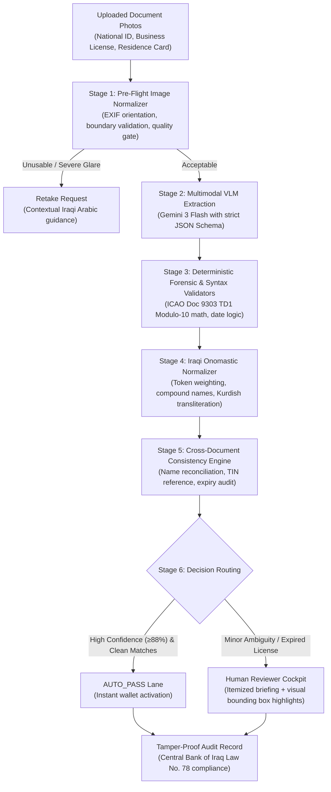

# Rostro — Autonomous KYC Document Agent

> **Agentic AI Challenge Iraq — Build Stage**  
> Organized by **ZainCash** in cooperation with **The Leaders of the AI Intelligence** & supported by **Young Arab Leaders**  
> **Topic 05:** KYC Document Agent  
> **Target Ecosystem:** Iraqi Digital Wallets & Merchant Onboarding (ZainCash, Qi Card)

---

## 🎯 Executive Summary
Customer and merchant onboarding in Iraqi fintech currently suffers from significant back-office bottlenecks. Compliance officers manually verify smartphone photos of Iraqi National Cards (*البطاقة الوطنية الموحدة*), Residence Cards (*بطاقة السكن*), and Chamber of Commerce Business Licenses (*إجازة ممارسة المهنة / غرفة التجارة*). Submissions frequently feature camera tilt, specular flash glare, Arabic cursive handwriting (*خط الرقعة*), and dialectal onomastic spelling variations.

**Rostro ** is an autonomous multimodal KYC verification agent that:
1. **Gates Capture Quality:** Detects blur, specular glare, and boundary truncation before heavy processing.
2. **Extracts via Multimodal VLM:** Uses Google Gemini (Gemini 3 Flash / Flash-Lite) to extract Arabic and Kurdish document fields with spatial bounding-box coordinates.
3. **Enforces "Blank and Flagged Beats Invented":** Never hallucinates missing or occluded fields; returns explicit nulls with calibrated confidence.
4. **Applies Deterministic Validators:** Validates ICAO Doc 9303 TD1 Modulo-10 checksums on National ID numbers, cross-checks dates, and normalizes Iraqi 4-part names.
5. **Empowers Human Reviewers:** Provides a 1-screen Compliance Reviewer Cockpit where clean files are auto-passed, and ambiguous edge cases are briefed in seconds.

---

## 🏛️ System Architecture



---

## 📋 Competition Rules & Clearance Adherence

| Rule / Clearance Check | Implementation in Rostro |
| :--- | :--- |
| **Commit History Spanning Build** | Continuous commit history tracking all architecture iterations, validators, and evaluation scripts. |
| **100% Synthetic Data** | Strictly **zero real customer records or personal IDs used**. All test documents are synthetic specimens generated with fake names, addresses, and deliberate visual degradations. |
| **Deterministic Rule Supremacy** | Regula ICAO Doc 9303 TD1 Modulo-10 checksums and Central Bank expiry rules govern verification. Decision tiers are bound by explicit deterministic logic, not arbitrary LLM verdicts. |
| **Calibrated Confidence** | Every extracted field outputs an explicit confidence score reflecting optical clarity and syntax validity. Low confidence triggers human escalation. |
| **Documented Failure Modes** | Distinct failure modes (specular flash glare, expired commercial licenses, dialectal name token drift) are safely detected and routed to human review. |
| **Full Disclosure** | Complete disclosure of models, libraries, and coding assistants used throughout development. |

---

## 🛠️ Stack & Technologies

* **Backend & Extraction Engine:** Node.js / Python FastAPI.
* **Multimodal Vision:** Google Gemini 3 Flash / Gemini 2.5 Flash (`thinkingBudget: 0`) with structured JSON schema output.
* **Forensics & Math:** Regula ICAO Doc 9303 TD1 Modulo-10 checksum algorithm (cyclic weights $[7, 3, 1]$).
* **NLP & Dialect Intelligence:** Custom Iraqi onomastic normalizer handling compound names (`عبد_الزهرة`), honorific stripping (`الشيخ`), and Arabic-Indic numerals (`٠-٩`).
* **Compliance Cockpit:** High-DPI canvas UI for visual document inspection, per-field bounding box overlays, and 1-click decision logging.
* **Audit & Integrity:** Cryptographic audit digests inspired by Central Bank of Iraq Electronic Transactions Law No. 78 of 2012.

---

## 🚀 Quickstart

### Prerequisites
* Node.js 18+ (or Python 3.11+)
* Gemini API Key from Google AI Studio

### 1. Setup Environment
```bash
cp .env.example .env
# Add your GEMINI_API_KEY inside .env
```

### 2. Install Dependencies & Run
```bash
npm install
npm start
```

### 3. Open the Cockpit
Visit `http://localhost:8080` to launch the **Compliance Reviewer Cockpit** and explore pre-configured synthetic Iraqi merchant scenarios or upload sample test images.

### 4. Run Automated Test Benchmark
```bash
node backend/tests/test_hybrid_server.js
```

---

## 📜 Full Disclosure of AI Usage & Tools
In compliance with the official challenge guidelines:
* **Models:** Google Gemini 3 Flash / Gemini 2.5 Flash (via Google AI Studio).
* **AI Coding Assistants:** Antigravity / Gemini 3.8 Flash for pair programming, test set synthesis, and architecture documentation.
* **Libraries:** Express / Node.js native crypto, PDFKit, Canvas, OpenCV.js.
