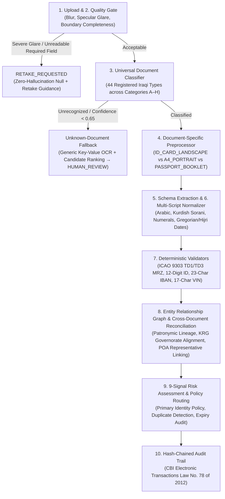

# Rostro (واثق) — Universal Iraqi Document Intelligence & KYC Agent

> **Agentic AI Challenge Iraq — Build Stage**  
> Organized by **ZainCash** in cooperation with **The Leaders of the AI Intelligence** & supported by **Young Arab Leaders**  
> **Topic 05:** KYC Document Agent  
> **Target Ecosystem:** Iraqi Digital Wallets, Citizen KYC & Merchant Onboarding (ZainCash, Qi Card)

---

## 🎯 Executive Summary
Customer and merchant onboarding in Iraqi fintech requires verifying a broad spectrum of federal Iraqi and Kurdistan Region (KRG) documents across multiple scripts (Arabic, Kurdish Sorani, and English), generations, and layouts. Rather than hardcoding a single 3-document check, **Rostro (واثق)** is a **Universal Iraqi Document Intelligence Platform** built around a centralized, startup-validated **Universal Document Registry (`44` document types across Categories `A–H`)** and a **10-Stage Shared Processing Pipeline**:

`Upload → Quality Gate → Classification → Preprocessing → Extraction → Normalization → Validation → Risk Assessment → Decision Routing → Audit`

Key engineering capabilities:
1. **Universal Document Registry (Categories A–H):** Covers Identity & Civil Status (`A`), Residence & Address (`B`), Travel & Immigration (`C`), Driving & Vehicle (`D`), Business & Merchant Onboarding (`E`), Education/Employment/Income (`F`), Financial Evidence (`G`), and Legal/Authorizations (`H`). See the full [Document Coverage Matrix](docs/DOCUMENT_COVERAGE_MATRIX.md).
2. **Universal Classification & Unknown-Document Fallback:** Identifies document category, specific type, side, languages (`ar`, `ku`, `en`), issuing authority, and support status. When an unrecognized or unconfigured document is uploaded, Rostro **never forces it into a wrong category**—it preserves the evidence, runs a generic layout key-value fallback, ranks candidate categories, marks `UNSUPPORTED_OR_UNCERTAIN_CLASSIFICATION`, and routes to `HUMAN_REVIEW` so an officer can classify or register it.
3. **Document-Specific Preprocessing & Deterministic Rules:** Applies `ID_CARD_LANDSCAPE` vs. `A4_PORTRAIT` geometry rules (never rotating upright A4 certificates sideways) and runs only the validators configured for that document type (ICAO Doc 9303 TD1 3x30 MRZ on National IDs, TD3 2x44 MRZ on Passports, 23-char CBI IBAN on Bank Statements, 17-char Chassis VIN on Vehicle Registrations).
4. **9 Independently Inspectable Signals:** Explicitly separates `image_quality`, `text_extraction_confidence`, `classification_confidence`, `field_completeness`, `data_consistency`, `duplicate_detection`, `authenticity_indicators`, `external_authoritative_verification` (`EXTERNAL_VERIFICATION_UNAVAILABLE`), and `final_policy_decision`.
5. **Entity Relationship Graph & Legal Representative Linking:** Distinguishes individuals, legal business entities, household heads, and authorized representatives linked via Notarized Power of Attorney (`IRQ_POWER_OF_ATTORNEY`), and enforces the policy that supporting documents (Education/Employment/Utility) cannot independently establish primary identity.

---

## 🗂️ Universal Iraqi Document Categories (A–H)

| Code | Category ID | Category Name | Registered | TESTED | CONFIGURED | REGISTERED |
| :---: | :--- | :--- | :---: | :---: | :---: | :---: |
| **A** | `IDENTITY_CIVIL` | Identity & Civil Status Documents (وثائق الهوية والأحوال المدنية) | 9 | 3 | 2 | 4 |
| **B** | `RESIDENCE_ADDRESS` | Residence, Address & Household Documents (وثائق السكن والعنوان والأسرة) | 5 | 4 | 1 | 0 |
| **C** | `TRAVEL_IMMIGRATION` | Travel, Residency & Immigration Documents (وثائق السفر والإقامة والتأشيرات) | 3 | 2 | 1 | 0 |
| **D** | `DRIVING_VEHICLE` | Driving, Vehicle & Transport Documents (وثائق القيادة والمركبات والنقل) | 4 | 2 | 1 | 1 |
| **E** | `BUSINESS_MERCHANT` | Business & Merchant Onboarding Documents (وثائق التجار والشركات والأعمال) | 10 | 4 | 2 | 4 |
| **F** | `EDUCATION_EMPLOYMENT_INCOME` | Education, Employment & Income Documents (وثائق التعليم والتوظيف والدخل) | 5 | 2 | 1 | 2 |
| **G** | `FINANCIAL_EVIDENCE` | Financial & Supporting Evidence (الأدلة والوثائق المالية والمصرفية) | 4 | 1 | 0 | 3 |
| **H** | `LEGAL_AUTHORIZATION` | Legal, Judicial & Authorization Documents (الوثائق القانونية والعدلية والتخويلات) | 4 | 2 | 0 | 2 |
| **Total** | **8 Categories** | **[Full Coverage Matrix →](docs/DOCUMENT_COVERAGE_MATRIX.md)** | **44** | **20** | **8** | **16** |

---

## 🏛️ 10-Stage Shared Processing Architecture



---

## 📋 Competition Rules & Clearance Adherence

| Rule / Clearance Check | Implementation in Rostro |
| :--- | :--- |
| **Commit History Spanning Build** | Continuous modular commit history tracking registry, pipeline, synthetic corpus, UI, and test suite. |
| **100% Synthetic Data** | Strictly **zero real customer records or personal IDs used**. All 14 multi-document cases are fictional synthetic specimens marked with `SPECIMEN / عينة تركيبية`. |
| **Deterministic Rule Supremacy** | ICAO Doc 9303 TD1/TD3 Modulo-10 checksums, IBAN/VIN validators, and Central Bank expiry rules govern verification. |
| **9 Separated Signals & Honesty** | Explicitly separates image quality, OCR confidence, classification, completeness, consistency, duplicates, internal MRZ checks, and `EXTERNAL_VERIFICATION_UNAVAILABLE`. |
| **Unknown Document Handling** | Mandatory capability: unrecognized documents trigger generic layout extraction, candidate category ranking, and human review/registration. |
| **Full Disclosure** | Complete disclosure of models, libraries, and coding assistants used throughout development. |

---

## 🚀 Quickstart

### Prerequisites
* Node.js 18+
* Optional: Gemini API Key from Google AI Studio (for live image upload extraction)

### 1. Setup Environment
```bash
cp .env.example .env
# Optional: Add GEMINI_API_KEY inside .env for live image upload OCR
```

### 2. Run the Server
```bash
npm start
```

### 3. Open the Compliance Cockpit
Visit `http://localhost:8080` to explore:
- All **14 synthetic multi-document scenarios** across Categories `A–H`
- Interactive **Document Coverage Matrix (`44` Iraqi document types)**
- **9 Separated Verification Signals** & **Universal Field Table**
- **Unknown Document Registration** workflow

### 4. Run the Automated Verification Suite (55 Assertions)
```bash
node backend/tests/test_hybrid_server.js
```

---

## 📜 Full Disclosure of AI Usage & Tools
In compliance with the official challenge guidelines:
* **Models:** Google Gemini 2.5 Flash / Gemini 3 Flash (via Google AI Studio).
* **AI Coding Assistants:** Antigravity for pair programming, universal registry architecture, synthetic test corpus generation, and automated verification suite.
* **Libraries:** Node.js native HTTP & `crypto` modules, HTML5 Canvas.
