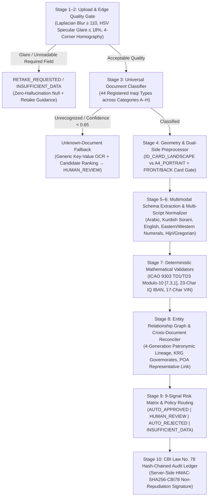

<div align="center">

# Project Rostro (`مشروع روسترو للامتثال`)
### Universal Iraqi & MENA Document Intelligence, Forensics & KYC Compliance Platform

[](https://github.com/voidaisystems/rostro-kyc/actions/workflows/ci.yml)
[](LICENSE)
[](package.json)
[](tsconfig.json)
[](src/App.tsx)
[-1d4ed8.svg)](docs/DOCUMENT_COVERAGE_MATRIX.md)
[_%26_Law_No._39_(2015)-b45309.svg)](SECURITY.md)

**[Architecture Specification](ARCHITECTURE.md)** · **[44-Document Coverage Matrix](docs/DOCUMENT_COVERAGE_MATRIX.md)** · **[Security Policy](SECURITY.md)** · **[Contributing Guide](CONTRIBUTING.md)** · **[Changelog](CHANGELOG.md)**

</div>

---

## Overview

Customer and merchant onboarding in the Iraqi financial ecosystem requires verifying a broad spectrum of **Federal Iraqi** and **Kurdistan Region of Iraq (KRG)** documents across multiple scripts (**Arabic**, **Kurdish Sorani**, and **English**), generations, physical substrates, and layouts.

Rather than hardcoding a brittle 3-document check, **Project Rostro (`روسترو للامتثال`)** is an enterprise-grade **Universal Document Intelligence Platform** built around a centralized, startup-validated **Universal Document Registry (`44` document types across Categories `A–H`)** and a **10-Stage Shared Processing Pipeline**:

```text
Upload → Edge Quality Gate → Classification → Preprocessing → Extraction → Normalization → Deterministic Validation → 9-Signal Risk Routing → Human Review → Cryptographic Audit
```

### Core Engineering Capabilities

1. **Centralized Universal Document Registry (`Categories A–H`):**
   Declaratively defines **44 Iraqi & KRG document types** covering Identity & Civil Status (`A`), Residence & Address (`B`), Travel & Immigration (`C`), Driving & Vehicle (`D`), Business & Merchant Onboarding (`E`), Education/Employment/Income (`F`), Financial Evidence (`G`), and Legal/Authorizations (`H`). See the complete [Document Coverage Matrix](docs/DOCUMENT_COVERAGE_MATRIX.md).
2. **Dual-Side Physical Card Enforcement (`FRONT + BACK`):**
   Two-sided Iraqi cards (`IRQ_NATIONAL_ID`, `IRQ_CIVIL_STATUS_ID`, `IRQ_RESIDENCE_CARD`, `IRQ_DRIVING_LICENSE`) strictly require both `FRONT` and `BACK` physical sides. Single-sided uploads are deterministically blocked from automatic approval (`MISSING_BACK_SIDE` / `MISSING_FRONT_SIDE`).
3. **Deterministic Mathematical Supremacy:**
   Generative Vision LLMs (`Gemini 2.5 Flash`) extract structured text and spatial bounding boxes (`[ymin, xmin, ymax, xmax]`), while **deterministic mathematical validators** govern ICAO Doc 9303 TD1 (`3×30`) and TD3 (`2×44`) Modulo-10 `[7, 3, 1]` check digits, 23-character Iraqi IBAN (`IQ`) Modulo-97 checks, and 17-character ISO 3779 Chassis VIN rules.
4. **Unknown-Document Fallback (`HUMAN_REVIEW` Safety Valve):**
   When an unrecognized or unconfigured document is uploaded, Rostro never forces it into a wrong category. It preserves the raw evidence, runs a generic key-value layout fallback, ranks candidate categories, marks `UNSUPPORTED_OR_UNCERTAIN_CLASSIFICATION`, and routes to `HUMAN_REVIEW`.
5. **9 Independently Inspectable Verification Signals:**
   Explicitly separates `image_quality`, `text_extraction_confidence`, `classification_confidence`, `field_completeness`, `data_consistency`, `duplicate_detection`, `authenticity_indicators`, `external_authoritative_verification` (`EXTERNAL_VERIFICATION_UNAVAILABLE`), and `final_policy_decision`.
6. **CBI Law No. 78 of 2012 Non-Repudiation Ledger:**
   Every automated decision and human officer adjudication is cryptographically sealed server-side with `HMAC-SHA256` (`HMAC-SHA256-CBI78-*`) and linked in an immutable SHA-256 hash chain (`prev_hash -> entry_hash`).

---

## Universal Iraqi Document Registry (`Categories A–H`)

| Code | Category Identifier | Domain Scope (English & Arabic) | Registered | `TESTED` | `CONFIGURED` | `REGISTERED` |
| :---: | :--- | :--- | :---: | :---: | :---: | :---: |
| **A** | `IDENTITY_CIVIL` | Identity & Civil Status (وثائق الهوية والأحوال المدنية) | 9 | 3 | 2 | 4 |
| **B** | `RESIDENCE_ADDRESS` | Residence, Address & Household (وثائق السكن والعنوان والأسرة) | 5 | 4 | 1 | 0 |
| **C** | `TRAVEL_IMMIGRATION` | Travel, Residency & Immigration (وثائق السفر والإقامة والتأشيرات) | 3 | 2 | 1 | 0 |
| **D** | `DRIVING_VEHICLE` | Driving, Vehicle & Transport (وثائق القيادة والمركبات والنقل) | 4 | 2 | 1 | 1 |
| **E** | `BUSINESS_MERCHANT` | Business & Merchant Onboarding (وثائق التجار والشركات والأعمال) | 10 | 4 | 2 | 4 |
| **F** | `EDUCATION_EMPLOYMENT_INCOME` | Education, Employment & Income (وثائق التعليم والتوظيف والدخل) | 5 | 2 | 1 | 2 |
| **G** | `FINANCIAL_EVIDENCE` | Financial & Supporting Evidence (الأدلة والوثائق المالية والمصرفية) | 4 | 1 | 0 | 3 |
| **H** | `LEGAL_AUTHORIZATION` | Legal, Judicial & Authorizations (الوثائق القانونية والعدلية والتخويلات) | 4 | 2 | 0 | 2 |
| **Total** | **8 Categories** | **[Explore Full Coverage Matrix →](docs/DOCUMENT_COVERAGE_MATRIX.md)** | **44** | **20** | **8** | **16** |

---

## 10-Stage Processing Architecture



---

## On-Device Edge & Server Document Forensics Stack

| Execution Layer | Tool / Engine | Verification Purpose | Deterministic Rule |
| :--- | :--- | :--- | :--- |
| **Phone Edge (Wasm)** | `OpenCV.js` Laplacian Variance | Measures optical sharpness at 30 FPS in the camera viewfinder before capture. | Blocks shutter if `blur_score < 110.0` |
| **Phone Edge (Wasm)** | `OpenCV.js` HSV Luminance Mask | Detects specular glare over polycarbonate holograms and MRZ zones (`V > 248`, `S < 15`). | Rejects frame if `glare_ratio > 0.18` |
| **Phone Edge (Wasm)** | Canny + `warpPerspective` | Locks onto the 4 corners of `ID_CARD_LANDSCAPE` (`85.6×54mm`) or `A4_PORTRAIT` sheets. | Requires `boundary_completeness >= 0.90` |
| **Phone Edge (Wasm)** | `MobileNetV3` (`ONNX` / `TFLite`) | `15ms` on-device side detector that guides the user to flip 2-sided cards. | Prompts *"Flip card to capture Back Side"* |
| **Phone Edge (Wasm)** | 2D Fast Fourier Transform (FFT) | Detects high-frequency pixel grid Moiré interference rings from screen-of-screen spoofing. | Rejects screen replay captures |
| **Server Pipeline** | `30ms` Orientation + `CLAHE` | Auto-rotates `90°/180°/270°` cards and enhances faded purple ink stamps on paper records. | Never rotates upright `A4_PORTRAIT` pages |
| **Server Pipeline** | ICAO Doc 9303 Modulo-10 `[7,3,1]` | Recomputes TD1 (`3×30`) and TD3 (`2×44`) MRZ check digits (`doc_number`, `dob`, `expiry`). | Zero generative LLM override permitted |
| **Server Pipeline** | `OpenCV SSIM` + Hough Circle | Compares primary photo vs. secondary laser ghost portrait and verifies circular ink seals. | Flags tampering if `SSIM < 0.82` |

---

## Repository Structure

```text
rostro-kyc/
├── .github/                        # CI workflows (.github/workflows/ci.yml), Issue & PR templates, CODEOWNERS
├── assets/branding/                # Official Rostro visual identity & brand mark specimens
├── backend/
│   ├── app/                        # Transaction risk & anti-scam Python services
│   ├── kyc_app/
│   │   ├── registry/               # Centralized 44-document Iraqi & KRG registry (iraqi_document_registry.js)
│   │   └── services/               # 10-stage UniversalKYCPipeline & hybrid multimodal engine
│   └── tests/                      # 55-assertion automated verification suite (test_hybrid_server.js)
├── data/synthetic_kyc/             # 14 synthetic Iraqi multi-document packets & Python Faker specimens
├── docs/                           # DOCUMENT_COVERAGE_MATRIX.md, engineering specs & PDF blueprints
├── frontend/kyc_cockpit/           # Production static assets & architectural blueprint viewer
├── scripts/                        # Python Faker synthetic specimen generator & PDF blueprint generators
├── src/                            # React 19 + TypeScript + Tailwind CSS v4 Compliance Workstation
│   ├── components/                 # ApplicantInspectorDrawer, DocumentSpecimenViewer, SecureUploadModal
│   └── utils/                      # Deterministic kycEngine.ts, unit tests, i18n.ts, seedData.ts
├── ARCHITECTURE.md                 # End-to-end system design & pipeline specification
├── CHANGELOG.md                    # Semantic versioning release notes
├── CODE_OF_CONDUCT.md              # Contributor Covenant v2.1 Code of Conduct
├── CONTRIBUTING.md                 # Developer onboarding, testing & document registration guide
├── LICENSE                         # MIT License
├── SECURITY.md                     # Coordinated vulnerability disclosure & cryptographic invariants
├── server.js                       # Production Node.js HTTP API & Workstation Server (port 8080)
└── server.ts                       # TypeScript Express + Vite middleware development server
```

---

## Quickstart

### Prerequisites
- **Node.js:** `>= 20.0.0`
- **Optional:** Google Gemini API Key (`GEMINI_API_KEY`) in `.env` for live multimodal image OCR extraction (the deterministic pipeline and all 14 synthetic Iraqi test packets run out-of-the-box without an external key).

### 1. Install & Configure
```bash
git clone https://github.com/voidaisystems/rostro-kyc.git
cd rostro-kyc
npm install
cp .env.example .env
```

### 2. Build & Start the Compliance Workstation
```bash
npm run build
npm start
```
Open **`http://localhost:8080`** in your browser to inspect:
- **Verification Queue:** Triage live Iraqi & KRG onboarding packets with full bilingual (`EN` / `AR`) switching.
- **Document Vault:** Browse the **44-Document Universal Iraqi Registry** across Categories `A–H`.
- **Dual-Side Specimen Inspector:** Flip between `FRONT` and `BACK` card sides, inspect spatial OCR bounding boxes, and verify ICAO Doc 9303 Modulo-10 check digits.
- **Audit Trail:** Verify immutable `HMAC-SHA256-CBI78` non-repudiation signatures and SHA-256 hash chains.

### 3. Run the Automated Verification Suites
```bash
# Run the 55-assertion Universal Iraqi KYC Pipeline test suite
npm test

# Run the TypeScript core KYC engine unit tests
npm run test:unit
```

---

## REST API Reference

| Method | Endpoint | Description |
| :---: | :--- | :--- |
| `GET` | `/api/kyc/health` | Returns engine readiness, registry version (`2.1.0`), and CBI Law No. 78 HMAC status. |
| `GET` | `/api/kyc/registry` | Returns the 8-category Iraqi Document Registry summary (`44` registered types). |
| `POST` | `/api/kyc/extract` | Runs multimodal zero-hallucination extraction, multi-script normalization, and ICAO Modulo-10 checksums on an uploaded image. |
| `POST` | `/api/kyc/adjudicate` | Records a compliance officer's decision and returns a server-signed `HMAC-SHA256-CBI78` receipt. |
| `GET` | `/api/v1/kyc/coverage-matrix` | Returns the complete 44-document registry matrix and support status breakdown. |
| `POST` | `/api/v1/kyc/verify` | Executes the full 10-Stage Universal KYC Pipeline on a multi-document onboarding packet. |

---

## Governance, Security & License

- **Architecture:** See [ARCHITECTURE.md](ARCHITECTURE.md) for the complete system blueprint.
- **Security Policy:** See [SECURITY.md](SECURITY.md) for our vulnerability disclosure process and CBI Law No. 78 cryptographic invariants.
- **Contributing:** See [CONTRIBUTING.md](CONTRIBUTING.md) for instructions on registering new Iraqi document types and running the verification suite.
- **License:** Licensed under the [MIT License](LICENSE). Copyright (c) 2026 Rostro Compliance Systems (`مشروع روسترو للامتثال`).
